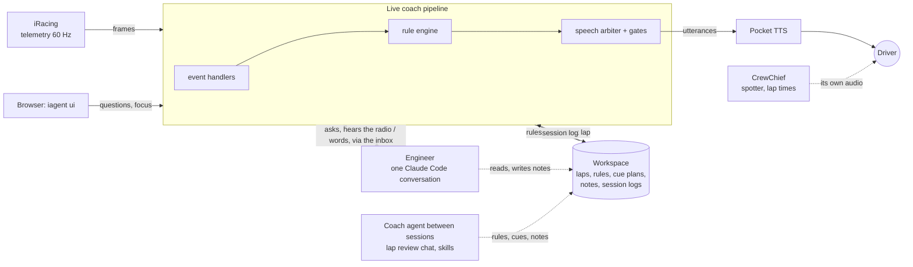
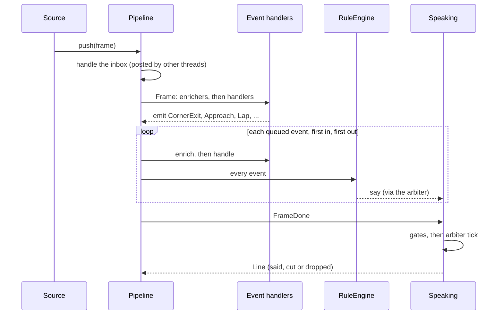
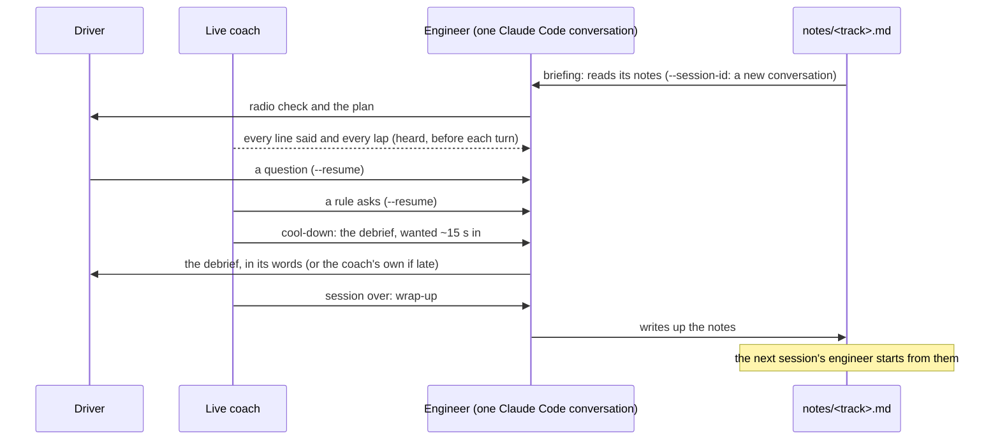

# Architecture

What the iRacing coach is for, how it's built, from a telemetry frame to a word in the driver's
ear, and how to extend it. The [README](README.md) covers using it.

## Contents

1. [Goals](#1-goals)
2. [The idea: a real race team](#2-the-idea-a-real-race-team)
3. [The system on the sim PC](#3-the-system-on-the-sim-pc)
4. [Code map](#4-code-map)
5. [Data: laps, tracks and the workspace](#5-data-laps-tracks-and-the-workspace)
6. [Analysis](#6-analysis)
7. [The live pipeline](#7-the-live-pipeline)
8. [Rules: everything said goes through them](#8-rules-everything-said-goes-through-them)
9. [Speech](#9-speech)
10. [The engineer: one conversation per session](#10-the-engineer-one-conversation-per-session)
11. [Between sessions: skills and the CLI](#11-between-sessions-skills-and-the-cli)
12. [Testing without the sim](#12-testing-without-the-sim)
13. [Extending it](#13-extending-it)
14. [Decisions, what's next, and open questions](#14-decisions-whats-next-and-open-questions)

## 1. Goals

**The problem: help the driver learn a new track.** The first test bed is Spa-Francorchamps.
Race-craft, strategy and fuel can come later on the same foundations.

Learning a track, as a coach would teach it:

1. **Map**: find the corners from recorded laps, and give them their real names.
2. **Compare**: per corner, the driver against a reference lap (brake point, minimum speed,
   throttle pickup), and how *consistent* the driver is across recent laps.
3. **Focus**: one thing at a time ("this session: Bus Stop brake point, 15 m later").
4. **Cue**: say it at the right place on track, in a few words.
5. **Debrief**: between runs, look at what happened and update the plan.
6. **Remember**: carry progress and the driver's notes from one session to the next.

Progress shows as the lap-time gap to the reference closing, the spread of each corner's brake
point (in metres) shrinking over a session, and how long it takes until N corners are within
tolerance.

Constraints that shape everything else:

- **Don't build an agent harness.** Plug into an existing one: Claude Code first, while the repo
  stays usable from any harness that reads Agent Skills and can run a shell.
- **Behaviour lives in skills** (markdown), **capability in a CLI** (`iagent ...`, JSON output).
  Changing how the coach coaches between sessions means editing a `SKILL.md`, not code.
- **No per-token API bills.** Models are Claude through a Claude subscription (which only Claude
  Code may use) or open-weight models run locally.
- **Fully testable without the sim** ([section 12](#12-testing-without-the-sim)).

Not goals, for now: replacing CrewChief's spotter and fuel calls, VR, more than one driver.

## 2. The idea: a real race team

The coach is built the way a real team works with a driver, and each role has one home in the
code:

| Role | Here | Model? | Job |
| --- | --- | --- | --- |
| Spotter | CrewChief | no | Cars alongside, lap times, gaps, fuel, flags. The coach stays out of its way. |
| Driving coach on the radio | the live pipeline and its built-in rules (`iagent/live/`) | no | Corner cues timed to the brake point, feedback after a corner, one focus, the lap summary. |
| Race engineer | the engineer: one Claude Code conversation per session (`iagent/live/engineer.py`) | yes | Radio check and plan, the driver's questions, rule wake-ups, the cool-down debrief, notes afterwards. |
| Data engineer | the coach agent between sessions: the lap review chat and the skills (`coach/skills/`) | yes | Lap review, picking the focus, writing and backtesting rules, rewriting cues. |
| Notebook | `workspace/notes/<track>.md` and the session logs | no | What carries from one session to the next. |

Two rules follow from that, and the rest of the design hangs on them:

- **No model in the 60 Hz loop.** Everything time-critical (cues, feedback, what to hold back) is
  deterministic and runs on every frame. The model is asked only where there's time for an
  answer, never waited on, and always has a fixed-text fallback.
- **Behaviour is definitions.** Events, event handlers, rules, speech gates, causes of lost time
  and actions are each declared once; nothing in the core knows a particular one.

## 3. The system on the sim PC



Solid lines run every frame with no model; dotted ones involve the model and run off the
real-time path. A live session runs inside `iagent ui` (the Coaching tab) or `iagent live run`;
both run `iagent/live/run.py`, and a backtest replays recordings through the same coach. All three
build it with `LiveCoach.load`. Everything runs on the sim PC except, optionally, the model. For
development the same pieces run on a Mac against recorded `.ibt` files.

### The harness and the models

**Claude Code** is the harness. It is the only one a Claude subscription may be used in
(Anthropic restricted subscription sign-in to Claude Code and claude.ai in February 2026), it can
drive open models through Ollama's Anthropic-compatible endpoint
(`ANTHROPIC_BASE_URL=http://<host>:11434`), and it already has skills, shell access, file
editing, headless runs (`claude -p`) and resumable conversations.

Nothing depends on Claude Code beyond packaging: skills use only the open Agent Skills format and
call tools by running `iagent ...` in a shell; memory is plain files in the workspace; and running
the agent is one adapter, `Agent` in [`agent.py`](iagent/agent.py) ("send this message to this
conversation"). `ClaudeCode` runs `claude -p`; Codex, OpenCode or Goose would be the same few
lines with a different command.

Claude through the subscription is the practical choice. Local open models are a supported
fallback once they pass the skill evals: a coding-agent harness has a large prompt, and on the
hardware at hand (an M1 with 16 GB; the RTX 3070 belongs to the sim) only 8–20B models fit, and
those are unreliable at multi-step tool use. Usage limits are respected by asking the model per
lap or event, never per frame.

## 4. Code map

```text
iagent/
  agent.py            the agent harness: Agent (abstract), ClaudeCode (`claude -p`, one turn at a time)
  workspace.py        the workspace: lap stores, reference laps, corner maps (shared by the CLI and UI)
  telemetry/          frames, session info, sources (.ibt replay; synthetic in testing/)
  laps/
    lap.py            Lap: one lap, its validity, and (when loaded) its samples
    segment.py        LapSegmenter: frames in, laps out
    resample.py       a lap on a 1 m distance grid
    store.py          LapStore (the interface), ParquetLapStore
    pace.py           best times, representative laps
    recorder.py, watch.py, tracks.py   ingesting a source, watching the telemetry folder, track info
  analysis/           corner map and metrics (shared with the live coach), comparisons, traces
  references/         Garage61, iRacing ghost files
  live/
    coach.py          LiveCoach: the pipeline with its handlers, and `load` (a coach from the workspace)
    pipeline.py       Pipeline, EventHandler (the base class), @on / @enrich
    events.py         every event, as a typed dataclass
    state.py          CoachState: the shared state, typed
    settings.py       Settings
    handlers/         laps, track, clock, pace, corners, positions, cue_caller, focus, history,
                      summary, debrief, engineer_link (to the engineer), speaking (and the gates)
    rules/            schema (the rule format), actions (Action subclasses), engine (RuleEngine)
    builtin_rules.py  the coach's own behaviour, as rules
    phrasing.py       every template; causes of lost time (Cause subclasses)
    expr.py           the small expression language rules are written in
    speech.py         the speech arbiter, utterances, voices
    engineer.py       Engineer: the session's conversation, its prompts
    rulebook.py       rules on disk, activation, backtests
    cues.py           cue plans (built per track and car)
    crewchief.py      sharing the radio with CrewChief
    session.py        live sessions run from the browser, and their logs
    report.py         a coached session, read back from its log
    run.py            running a coach over a stream of frames (new session: new coach; rules reload)
    sources.py, voice.py   iRacing and replay sources, Pocket TTS
  ui/                 `iagent ui`: the local API and the lap review chat
  cli/                the `iagent` command: one module per command group (laps, corners, rules, ...)
  testing/            synthetic laps, an .ibt writer, fakes for Garage61 and the web
coach/skills/         the coach's skills (lap review, reference laps, live rules, ...)
web/                  the browser UI (React)
```

## 5. Data: laps, tracks and the workspace

**Frames.** A timestamped set of channels, 60 times a second. Time is iRacing's `SessionTime`,
never the wall clock, so replays are deterministic and can run faster than real time (a
30-minute session replays in under a second).

**Laps.** The segmenter turns frames into laps: a lap starts and ends where `LapDistPct` wraps
past the line, timed to a fraction of a frame by interpolating between the two frames either
side. A [`Lap`](iagent/laps/lap.py) is the same type whether it was just segmented (it carries
its samples) or listed from the store (it doesn't; `LapStore.load` gives them).

- **Identity.** Laps are grouped by `track_key` (iRacing's internal track name, e.g.
  `spa-2024-up`, one per layout and scan) and `car_key` (iRacing's car path, e.g. `formulair04`).
  Display names are kept for people. Laps on different keys are never compared.
- **Valid vs representative.** `valid` is structural only: complete, no pit road, no position
  jump (a reset or tow). Time off track is recorded but never disqualifies a lap: a brief clip of
  the kerb is normal. A *representative* lap is a valid one within 5% (by default) of the best
  valid lap for the same track and car. On real Okayama, Spa and Watkins Glen recordings this
  separates normal laps from excursions and slow laps, and keeps a best lap that had a brief
  off.

**The lap store.** Each lap is one Parquet file of raw samples plus a copy resampled onto a 1 m
distance grid, so laps compare point for point; a SQLite index holds the rest of the `Lap`.
Callers use the `LapStore` interface; the format is a detail. Other drivers' laps live in a
separate store, so they never count as the driver's best or move the pace filter.

**The workspace** is the driver's data, and everything the agent changes is a file in it:

```text
workspace/
  laps/<track>/<car>/<lap_id>.parquet   the driver's laps (+ .grid.parquet), indexed in index.sqlite
  reference/                            other drivers' laps: a lap store of their own + meta/<lap_id>.json
  tracks/<track>/corners.json           the corner map, with names (agent-editable)
  tracks/<track>/knowledge.md           researched names, quirks, sources
  tracks/<track>/track.json             iRacing's track and car ids, names, length (from ingest)
  tracks/<track>/cues/<car>.json        the corner cue plan
  rules/<track>/<id>.json               rules (draft, active or archived) and their last backtest
  rules/_any/<id>.json                  rules for every track
  notes/driver.md                       who the driver is, goals, preferences
  notes/<track>.md                      the engineer's notebook for the track
  sessions/live/<id>.jsonl              each coached session's log (every logged event)
  cache/                                downloads (CrewChief landmarks, Garage61 catalogues, voices)
  scratch/                              the agent's free space (scripts, plots)
```

**Track knowledge** comes in two layers. The geometry is derived: the corner map
([section 6](#6-analysis)). The names are attached: each corner carries an optional name with its
source (`driver`, `crewchief`, `web`, `model`) and confidence, and names survive re-mapping.
Sources by trust: the driver's corrections; CrewChief's MIT-licensed landmarks file (about 25
iRacing tracks, last updated 2019, names sometimes misspelled or generic, its Spa distances
within ~50 m of ours); a web search; the model's own memory (low confidence). The
`name-corners` skill does this.

## 6. Analysis

The deterministic layer that makes the agent cheap and reliable: the code computes the numbers,
and the model chooses what matters and how to say it. The model never has to work out a brake
point from raw samples.

- **The corner map** ([`analysis/corners.py`](iagent/analysis/corners.py)). A corner is a stretch
  of sustained lateral g in the median of representative laps (smoothed over ~30 m; on above 45%
  and off below 20% of the car's 98th-percentile lateral g, so it adapts to the car). A change of
  direction splits a corner (chicanes); parts in the same direction closer than 60 m merge
  (double apexes). The apex is the slowest point, or the peak lateral g for a corner taken flat.
  The map also cuts the lap into one segment per corner, each starting at the last top-speed
  point before the braking zone, so per-corner time deltas add up exactly to the lap delta. On
  real Spa laps it finds 16 corners that line up with the circuit's named ones.
- **Per-corner metrics**: segment time, where braking starts, entry, minimum and exit speed,
  where full throttle is reached (and held for 20 m), lowest gear, and metres off track (so an
  incident reads as one). The live coach runs the same code at each corner exit, so the analysis,
  the rules and their backtests agree.
- **Comparison and consistency**: corner by corner against a reference lap, and the spread of each
  metric across representative laps, the main measure of learning a track. Also distance splits,
  section comparisons and channel traces.
- **Reference laps.** The driver's own best by default, or other drivers' laps from **Garage61**.
  Any command that takes a lap id takes a reference lap's. What we rely on from Garage61:
  - A personal access token reaches the driver's own laps and their Garage61 **teammates'**.
    Searching every visible lap needs an application Garage61 approves.
  - Laps match exactly on iRacing's track and car ids, recorded per track at ingest in
    `track.json`.
  - The telemetry CSV is 60 Hz iRacing channels with no time column: time is rebuilt from the
    sample index, and the trailing sample past the line pins the crossing (a real export
    reproduces its 1:55.992 to 0.3 ms). A lap's `canViewTelemetry` flag can say no while the CSV
    downloads fine, so the download is the authority.
  - Ghosts: `/laps/{id}/ghost.bin` is iRacing's own `.blap` file. `iagent garage61 ghost
    --install` copies it into `Documents/iRacing/lapfiles/<track>[/<config>]` under a `g61_`
    name, never over the driver's own file.

## 7. The live pipeline

### Events

Everything the live coach knows or does is an event, and every event is a typed dataclass in
[`iagent/live/events.py`](iagent/live/events.py). Its fields are its schema, each with a
description, so rules can use them and `iagent rules vars` lists them straight from the classes.

```python
@dataclass(kw_only=True)
class CornerExit(Event):
    """Just past a corner's exit, with its metrics against the reference lap."""
    name: ClassVar[str] = "corner_exit"      # how rules and the session log refer to it
    judged: ClassVar[bool] = True            # about driving: ignored while not pushing
    corner: int = doc("the corner", 0, corner=True)
    delta_s: float = doc("time lost (+) or gained (-) vs the reference", 0.0)
    ...
```

Class attributes say how an event is treated: `name` (for rules and the log), `log` (written to
the session log, which the review page reads) and `judged` (rules with `pushing_only` ignore it
while the driver isn't pushing). Only a class with a `name` is an event the pipeline carries.

Inheritance means "is a kind of", and the pipeline relies on it: a method marked for a class gets
its subclasses too. Shared fields go in a base class without a `name`, which is never emitted
itself: `Crossing` (every time the car crosses the line) and `Lap` (a counted lap) both extend
`AtTheLine`, so a handler of `AtTheLine` sees both, while one of `Crossing` doesn't see laps.

| Group | Events |
| --- | --- |
| The pipeline | `Frame`, `FrameDone`, `SessionStart`, `SessionEnd`, `Clock` |
| The car | `Pit`, `PaceChanged`, `Slowing`, `CoolDown`, `Crossing`, `Lap` |
| Corners | `CornerExit`, `Advice` |
| Points on track | `Watch`, `Unwatch`, `Approach` |
| The focus | `FocusChanged`, `SetFocus` |
| Speech | `Line` (said, cut or dropped), `RuleFired` |
| The debrief | `DebriefLine`, `DebriefGiven` |
| From the driver and the browser | `Say`, `SetFocus`, `AskEngineer` (a question) |
| The engineer | `AskEngineer`, `EngineerAsked`, `EngineerReply` |
| Problems | `Error` |

### Event handlers

An event handler subclasses `EventHandler` and marks the methods for the events it acts on. An
enricher adds to an event before anyone acts on it; a handler acts on it:

```python
class Summary(EventHandler):
    @enrich(Lap)
    def words(self, e: Lap):
        e.summary_text = phrasing.summary(...)   # saying it is a rule's job
```

| Event handler | Handles | Adds to events, or keeps in the state | Emits |
| --- | --- | --- | --- |
| `Laps` | `Frame`, `Crossing` | lap, laps driven, line time, learning | `Crossing` (handled at once), `Lap` |
| `Track` | `Frame`, `Crossing` | on track, car alongside, lap clean | `Pit` |
| `Clock` | `Frame` | seconds since the start | `SessionStart`, `Clock` |
| `Pace` | `Frame`, `Crossing`, `Lap` | pushing or not, slow stretches, best lap; a lap's pace, new best | `PaceChanged`, `Slowing`, `CoolDown` |
| `Corners` | `Frame`, `Crossing`, `Lap` | a lap's corner results, its worst corner | `CornerExit` |
| `Positions` | `Watch`, `Unwatch`, `Frame` | when the next timed point is due | `Approach` |
| `CueCaller` | `Approach`, `Frame` | a cue's `wanted` and `text`; cues heard; in a corner | `Watch` (one per cue) |
| `Focus` | `SessionStart`, `SetFocus`, `Lap` | the focus; a lap's `focus_news` | `FocusChanged`, `Error` |
| `History` | `CornerExit`, `Crossing` | struggling corners, hints; a corner exit's `feedback` | `Advice` |
| `Summary` | `Lap` | a lap's `summary_text` | |
| `Debrief` | `Lap`, `PaceChanged`, `Slowing`, `CoolDown`, `EngineerAsked`, `EngineerReply`, `Frame` | debriefs given | `AskEngineer`, `DebriefLine`, `DebriefGiven` |
| `EngineerLink` | `AskEngineer`, `Line`, `Lap`, `SessionStart`, `SessionEnd` | | `AskEngineer`, `EngineerAsked`; posts `EngineerReply` |
| `RuleEngine` | every event | | `Watch`, `RuleFired`, `AskEngineer`; speaks through the arbiter |
| `Speaking` | `FrameDone` | | `Line` |

Event handlers decide *what's worth saying* and put it on events (`wanted` and `text` on a cue's
`Approach`, `feedback` on `CornerExit`, `summary_text` and `focus_news` on `Lap`); rules decide
*to say it*. Event handlers share only the typed state, [`CoachState`](iagent/live/state.py), whose
fields every rule can read, and otherwise talk only through events.

### One frame



- **Only defined events.** `@on` and `@enrich` take only `Event` classes, an `EventHandler` that
  marks no methods is refused, and only named events can be emitted or posted. Anything else is a
  `TypeError` when the coach is built, not a silent no-op on track.
- **Order.** For each event every enricher runs, then every handler, in the order the handlers
  were added ([`handlers/__init__.py`](iagent/live/handlers/__init__.py)), whether a method is
  marked for the event's own class or a class above it; the rule engine comes after all the other
  handlers, `Speaking` last. Events emitted meanwhile are queued and handled first in, first out,
  so a replay at any speed makes the same decisions as the live session.
- **The one nested event.** A line crossing is handled at once (`dispatch`) inside the frame that
  crossed, so the frame that starts the new lap is counted in it.
- **Threads.** Only the coach's thread touches the pipeline. The browser and the engineer `post`
  events into a thread-safe inbox, handled at the next frame; nothing needs locks.

## 8. Rules: everything said goes through them

A rule is data: an event, an optional condition, actions and limits
([`iagent/live/rules/`](iagent/live/rules/)). The coach agent writes them between sessions; the
live coach runs them.

```json
{"id": "bus-stop-early-brake", "track": "spa-2024-up",
 "when": {"event": "corner_exit", "corner": 18},
 "if": "brake_diff_m < -10",
 "actions": [{"say": "{name}: braked {round5(-brake_diff_m)} metres early.", "priority": "feedback"}],
 "limits": {"cooldown_laps": 1}}
```

- **Strict, structured, never normalised.** The format is a JSON Schema generated from the event
  classes ([`rules/schema.py`](iagent/live/rules/schema.py), `iagent rules schema`): each event's
  `when` allows exactly its own fields, typed from the dataclass (a corner is an integer). Nothing
  turns "T9" or "turn 9" into 9: the writer (the agent) looks the number up in the corner map
  (`iagent corners list --json`), and a rule naming a corner the track doesn't have is rejected
  with the corners it does have. Errors name the field (`when.corner: 'T9' is not valid ...`).
- **`when`** names any event and filters on its fields (a value or a list; leave a field out for
  any) and an optional `where` condition. `approach` takes `at` (`{"corner": 9, "point": "apex"}`
  or `{"metres": 1830}`, with `lead_s`/`offset_m`, timed so a spoken line finishes before it);
  `frame` takes `edge` (a condition, edge-triggered with `for_s`/`rearm_s`).
- **Conditions and text** use a small expression language ([`expr.py`](iagent/live/expr.py)): a
  Python-syntax subset compiled to closures, no attribute access or arbitrary calls. A missing
  value makes a comparison false and keeps a line with that hole unsaid.
- **Actions** (a list) are subclasses of `Action` ([`rules/actions.py`](iagent/live/rules/actions.py)):
  `Say` (priority, a `long` version for when there's time, kind, expiry), `Ask` (`ask_engineer`: the
  engineer is asked and may answer on the radio) and `Log`.
- **Limits**: `cooldown_s`, `cooldown_laps`, `max_per_lap`, `max_per_session`, `once`,
  `in_a_row`, and `pushing_only` (default) for judged events.
- **Groups.** The coach's own behaviour is the built-in rules
  ([`builtin_rules.py`](iagent/live/builtin_rules.py), group `builtin`): the cue, the feedback,
  the lap summary, the focus news, the debrief, answers and the engineer's words. The agent's rules
  are group `agent`, which share a budget of six lines a lap and four seconds between lines.
- **Lifecycle.** `iagent rules add` checks a rule (fields, variables, corners) and saves it as a
  draft; `backtest` replays recorded sessions through the *same* `LiveCoach`, with the other
  active rules competing for the voice, and reports every firing and whether its line was said,
  cut or dropped, and why; `activate` needs a backtest of the rule as it is now. A running coach
  reloads rules when their files change.

## 9. Speech

The arbiter ([`speech.py`](iagent/live/speech.py)) owns the audio: one line at a time, the most
important first (cue, then feedback and answers, then the summary), nothing said once it has
expired (a corner cue is useless after the corner), and a corner cue cuts off anything less
urgent. A line may carry a longer version, said instead when the driver has time.

When not to speak is a list of gates ([`handlers/speaking.py`](iagent/live/handlers/speaking.py)),
each a condition over the shared state:

| Gate | When | Effect |
| --- | --- | --- |
| off track | not on track | hold; drop pending cues and feedback |
| car alongside | CrewChief's spotter is talking | hold |
| not pushing | out lap, cool-down, after a moment | longer versions allowed; drop pending cues as it starts |
| settling | just slowed down (maybe a moment) | hold |
| after the line | CrewChief reads the lap time | cues only |
| in a corner | between a cue's point and the corner's end | cues only |

**Delivery, like a coach on the radio.** A cue shortens to a reminder once the driver has heard it
in full. Feedback has a longer version (what, why, how) for when the driver isn't pushing and
there's room before the next cue. A cool-down lap (not pushing for 15 s) gets a debrief from the
last laps at pace: the costliest corner, how to fix it, consistency. A repeated mistake is said
as a repeat, and a fixed one gets a "better".

**The voice: Pocket TTS** (Kyutai, ~100M parameters, CPU, 2 threads), measured on an M1 at ~55 ms
to first audio when streaming and ~4.5× real time, so one engine serves cues, feedback and
answers. Cue texts are rendered when the session starts, so a cue costs no CPU at the brake zone
and its exact length sets when it starts. (Kokoro, the earlier choice, took ~3.7 s to first audio:
too slow for anything said in reaction.) Audio goes out in blocking writes from the voice's own
thread; a Python audio callback starved by the coach loop crackled.

**Sharing the radio with CrewChief** ([`crewchief.py`](iagent/live/crewchief.py)). CrewChief does
the spotter's and race engineer's calls (cars alongside, lap times, gaps, fuel, flags); the coach
does technique only. With CrewChief running (or `--crewchief on`), the lap summary leaves out the
lap time and gap, only cues are said for 5 s after the line, and `rules add` flags rules that
would duplicate it. CrewChief has no API for arbitrary speech, so the coach keeps its own audio.

## 10. The engineer: one conversation per session



- **One conversation** per live session, with a fixed id: `--session-id` on the first turn,
  `--resume` after. The session log records it, so the debrief written later on the review page
  continues the same conversation.
- **One turn at a time**, most important first; a request that's stale by its turn is dropped and
  the live coach says its own words instead:

  | Turn | Priority | Worth answering for |
  | --- | --- | --- |
  | the driver's question | 1 | 60 s |
  | the cool-down debrief | 2 | 20 s |
  | a rule asking | 3 | 20 s (at most one every 30 s) |
  | the briefing | 4 | 90 s |
  | the wrap-up | 5 | 10 min |

- **Structured replies.** Each kind of turn (`TURNS` in `engineer.py`) asks for a reply in a JSON
  Schema (`claude -p --json-schema`): `{"say": "..." | null}` for words on the radio,
  `{"changed": "..."}` for the wrap-up. What's spoken is a field, and silence is `null`: no
  parsing of free text, no magic "SILENT" word.
- **It listens.** Each turn starts with what went out on the radio and the laps since its last
  turn, so it knows what the driver heard.
- **Isolated.** Its own conversation, the coach plugin, and only the tools the coach needs
  (`iagent`, reading and editing workspace files); nothing from the driver's other sessions.
- **Memory between sessions is the notebook**, not an ever-longer conversation: a new session
  starts a new conversation that reads the notes, which also keeps turns fast (about 5 s).

The other conversations follow the same idea:

| Conversation | Lives | Holds |
| --- | --- | --- |
| The live session's engineer (`iagent/live/engineer.py`) | one live session: radio check to wrap-up | everything said on the radio, the laps, the driver's questions, wake-ups, debriefs |
| The lap review chat (`iagent/ui/chat.py`) | as long as the browser keeps it | the driver's questions about a lap |
| The workspace notes (`notes/<track>.md`) | across sessions | what was worked on, what changed, what to start with |

## 11. Between sessions: skills and the CLI

The coach agent is Claude Code with the `coach` plugin, working on the workspace through the
`iagent` CLI. The repo is its own plugin marketplace:

```text
.claude-plugin/marketplace.json   makes the repo a Claude Code marketplace
coach/
  .claude-plugin/plugin.json
  skills/
    telemetry/SKILL.md            find, inspect and compare laps and corners
    lap-review/SKILL.md           review a session's laps and give one focus
    name-corners/SKILL.md         name derived corners, record track knowledge
    reference-laps/SKILL.md       pick, import and coach from a faster Garage61 lap
    live-rules/SKILL.md           write, backtest and activate rules for the live coach
```

The lap review chat in the browser is the same agent, in its own conversation. Other harnesses
point their skills directory at `coach/skills/`.

**The CLI is the agent's hands.** Every command an agent uses takes `--json` (or writes CSV for
bulk traces), has a `--help` accurate enough to be the documentation, finds the workspace from
`--workspace` or `IAGENT_WORKSPACE`, and reports errors on stderr with a non-zero exit code.
Each command group is a module in [`iagent/cli/`](iagent/cli/).

| Command | Does |
| --- | --- |
| `iagent ingest <file.ibt>` | segment a recording into the lap store |
| `iagent tracks`, `iagent workspace` | tracks and cars with lap counts and best times; where the workspace is |
| `iagent laps list/show/compare/trace` | laps with validity and pace; a lap's splits; time gained and lost against a reference; channel traces (CSV) |
| `iagent corners map/list/name/landmarks` | derive, show and name the corner map; CrewChief's names matched to it |
| `iagent corners report/compare/consistency` | per-corner metrics for a lap, against a reference, and their spread across laps |
| `iagent garage61 status/find/import/ghost` | find and import teammates' (and own) Garage61 laps; download and install a lap's ghost |
| `iagent refs list` | imported reference laps |
| `iagent cues build/show/set` | the corner cue plan |
| `iagent rules add/list/show/vars/schema/backtest/activate/deactivate/archive/remove` | the rules the live coach runs |
| `iagent live run` | the live coach, on iRacing or a replayed `.ibt` |
| `iagent ui` (`ui show`) | the browser app (and pointing it at a lap, corner or distance) |

## 12. Testing without the sim

Only the telemetry source and the ends of the audio touch the sim or hardware, so each has a
stand-in:

| Seam | Real | In tests |
| --- | --- | --- |
| `TelemetrySource` | iRacing (irsdk) | `.ibt` replay, synthetic laps with exact ground truth |
| The agent | `claude -p` | a recorded command line (what the agent would be told) |
| Audio out | speakers | captured (time, text, priority) |

The layers:

1. **Unit**: segmentation, resampling, the store, analysis, rules, the pipeline, the arbiter.
2. **Real recordings** (`tests/real/`, skipped without the files): lap times match iRacing's own
   `LapLastLapTime`, and the representative laps per file are pinned. The recordings live in
   `data/telemetry/` (not committed): Okayama, Spa, Silverstone (F4) and Watkins Glen (GT3).
3. **CLI contract**: every agent-facing command's `--json` shape.
4. **Skill evals** (planned): scenario workspaces and a prompt, run headless with each candidate
   model, checked programmatically (the right commands run, the numbers in the answer come from
   the CLI, the answer's length). This is the gate for a local model.
5. **On the rig** (by hand, with the sim running).

`uv run pytest` runs everything; no sim, GPU, model or network is needed.

## 13. Extending it

Each of these is a definition; nothing else changes.

**A new event.** A dataclass in `events.py` (or anywhere: subclassing registers it). It is
immediately usable in rules and listed by `iagent rules vars`.

```python
@dataclass(kw_only=True)
class KerbStrike(Event):
    """The car hit a kerb hard."""
    name: ClassVar[str] = "kerb_strike"
    judged: ClassVar[bool] = True
    jolt: float = doc("vertical acceleration (m/s²)", 0.0)
```

**A new detector.** An event handler that emits it, added to `HANDLERS` (or passed to
`LiveCoach(handlers=...)`):

```python
class KerbDetector(EventHandler):
    @on(Frame)
    def jolt(self, e: Frame):
        if (e.frame.get("VertAccel") or 0) > 20:
            self.emit(KerbStrike(jolt=e.frame.get("VertAccel")))
```

**A new behaviour.** A rule: the agent's (`iagent rules add`), or a built-in one in
`builtin_rules.py`:

```json
{"id": "kerbs", "when": {"event": "kerb_strike"}, "if": "jolt > 25",
 "actions": [{"say": "Easy on the kerbs."}], "limits": {"cooldown_laps": 2}}
```

**A new reason to keep quiet.** A `Gate` in `GATES`. **A new cause of lost time.** A `Cause`
subclass in `phrasing.CAUSES`. **A new action.** An `Action` subclass in `rules.actions.ACTIONS`.
**A new harness.** An `Agent` subclass. **A new command.** A function in its group's module in
`iagent/cli/`, or a new module registered in `iagent/cli/__init__.py`.

`tests/live/test_pipeline.py` adds a detector, an event and a rule, and a gate, this way.

## 14. Decisions, what's next, and open questions

**Built.** Telemetry sources, laps and the lap store; the agent-facing CLI and the coach's skills;
corner analysis; Garage61 reference laps and ghosts; the live coach on iRacing or a replay (cues,
feedback, focus, the pace gate, speech, sharing the radio with CrewChief); rules with backtests;
one engineer conversation per session, with notes across sessions; the browser UI for lap review,
the library and coached sessions.

**Next, and where each fits:**

- **Radio control.** A radio level in the state (full, focus only, critical only, silent) and how
  often the engineer may speak up, set by the engineer, overridden by the driver ("leave me
  alone", "talk to me") until the driver lifts it; every line gets an importance. It fits as
  driver command events, one field in `CoachState`, and one gate.
- **Push-to-talk.** Local speech-to-text on the sim PC's CPU (faster-whisper `small`, Parakeet or
  Moonshine) posting the same `AskEngineer` question the Coaching tab does.
- **A standalone live service** on the sim PC owning the pipeline and the engineer, with the UI
  and CLI as its clients (today both build `LiveCoach` themselves through `run.py`).
- **Saved settings** in the workspace's `settings.json`, with per-run overrides.
- **Analysis**: a theoretical best (the best corner segments stitched together), and importing
  other `.ibt` or CSV laps by hand.
- **SimHub**: a small plugin exposing the current cue to dashboards and overlays, and wheel-button
  actions (repeat the cue, mute, push-to-talk).

**Open questions and risks:**

- **CrewChief pace notes** for a "learning a new track" mode. They'd go through CrewChief's own
  audio queue, but they're fixed recordings at fixed points, so they'd lose thinning, short
  forms, timing at the current speed, silence when not pushing, and rules' conditional cues. It
  needs testing on the rig.
- **Local models** in a coding-agent harness on this hardware; mitigated by the deterministic
  analysis, short skills and the eval gate, with Claude through the subscription first.
- **CPU on the sim PC** (Ryzen 5 7600X) with iRacing, SimHub, CrewChief, speech and the coach
  running: not yet measured.
- **Corner maps from few laps** (Silverstone has one) are noisier; re-map as laps come in. Maps
  are derived from one car's laps, and a much faster car may take some corners flat that another
  brakes for; geometry is shared per track for now.
- **Garage61 reach** is limited to teammates with a personal token; a wider pool of reference
  laps needs an approved Garage61 application or laps shared by coaches.
