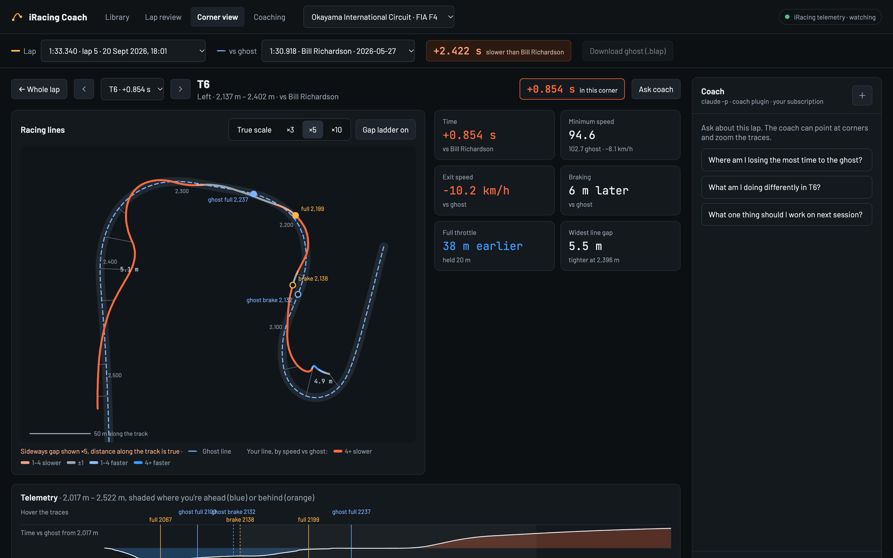

# iRacing Agent: an AI coach for learning tracks



A coach for learning iRacing tracks. It compares your laps with a faster one corner by corner,
picks one corner to work on, and talks you through it on track.

- **Lap review** against your best lap or a Garage61 teammate's: brake points, minimum speed,
  throttle and racing line per corner.
- **Live coaching:** spoken corner cues timed to the reference brake point, feedback after a
  slow corner, and one focus corner at a time. It stays quiet when you're not pushing, and works
  alongside CrewChief.
- **Race engineer:** a Claude Code conversation for the whole session. It answers questions,
  debriefs on the cool-down lap and keeps notes for next time.
- **Rules:** the coach can add its own triggers (e.g. "wide at Pouhon twice"), tested on past
  recordings before going live.
- **Ghosts:** installs a teammate's Garage61 lap into iRacing to drive against.

## How it's built

- Runs inside Claude Code (Claude subscription, or local models via Ollama) or any harness that
  supports [Agent Skills](https://agentskills.io).
- Skills in [coach/skills/](coach/skills/) tell the model what to do. The numbers come from the
  `iagent` CLI.
- The live coach runs on every telemetry frame without a model. The engineer only speaks when
  there's time, and fixed text is used if it doesn't answer.
- Everything can be tested without iRacing: `.ibt` replays, synthetic laps and real recordings.

Details: [ARCHITECTURE.md](ARCHITECTURE.md).

## Quick start

```bash
uv sync --extra voice
uv tool install --editable .                 # puts `iagent` on your PATH (or use `uv run iagent`)
npm --prefix web install && npm --prefix web run build   # build the browser UI

iagent ui                                    # http://127.0.0.1:8765
iagent live run                              # on the sim PC, waits for iRacing

claude plugin marketplace add /path/to/iracing-agent && claude plugin install coach@iracing-agent
```

On the sim PC, `iagent ui` imports new recordings from Documents/iRacing/telemetry (Alt+L
records in iRacing). On another machine, drop `.ibt` files onto the library or run
`iagent ingest`. No recordings: `iagent ingest synthetic --laps 7 --messy`. Garage61 needs
`GARAGE61_TOKEN`.

## Docs

- [Laps, corners and reference laps](docs/laps-and-corners.md)
- [Browser UI](docs/browser-ui.md)
- [Live coaching](docs/live-coach.md)
- [Coach skills](docs/coach-skills.md)
- [Architecture](ARCHITECTURE.md)

## Roadmap

| Phase | Scope | State |
| --- | --- | --- |
| 1 | Telemetry sources, lap segmentation, lap store | **Done** |
| 2 | `iagent` CLI, coach plugin and skills | **Done** |
| 3 | Corner maps and comparisons, Garage61 laps and ghosts | **Done** |
| 4 | Live coach: cues, feedback, focus, speech, CrewChief, rules | **Done** |
| 5 | Race engineer per session, debriefs, notes | **Done** |
| 6 | Browser UI: library, lap review, corner view, session review, debug view | **Done** |
| 7 | Push-to-talk (done), control over how much the coach says | In progress |
| 8 | Standalone service on the sim PC, saved settings, SimHub plugin | Planned |
| 9 | Theoretical best lap, local-model evals, CPU load on the rig | Planned |

## Requirements

- Python 3.12+ and [uv](https://docs.astral.sh/uv/)
- Claude Code (or [Ollama](https://ollama.com) v0.14+ for local models), or another harness
  that supports skills
- Node.js 20+ to build the browser UI
- iRacing only for live coaching; everything else works from `.ibt` files

## Tests

```bash
uv run pytest
```

Runs without iRacing, a GPU, a model or a network. `tests/real/` uses your recordings in
`data/telemetry/` (git-ignored) and is skipped without them.

## License

All rights reserved.
(I may change my mind later. If you are keen to contribute - let me know!)
