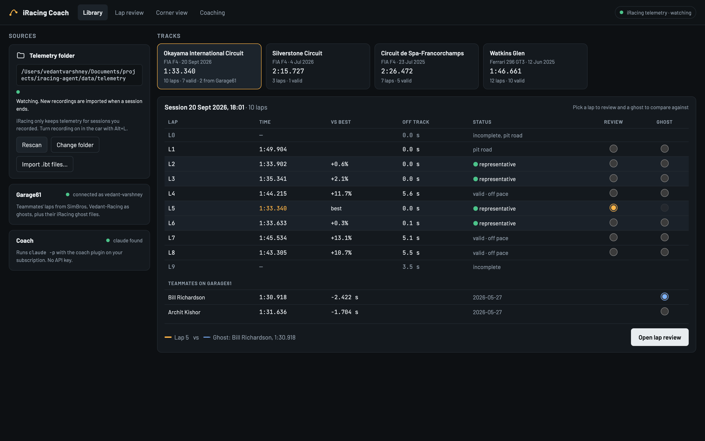
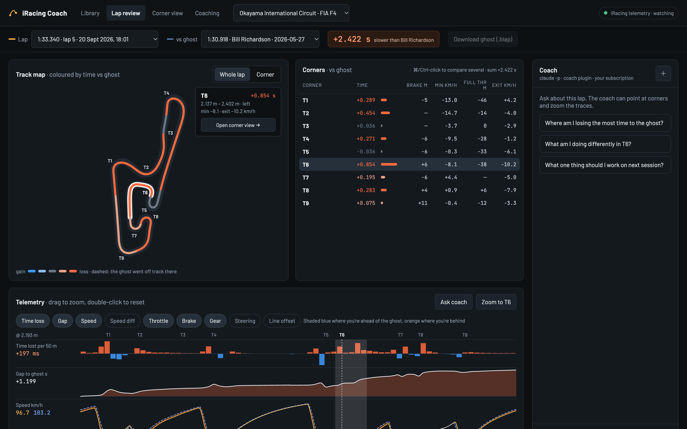
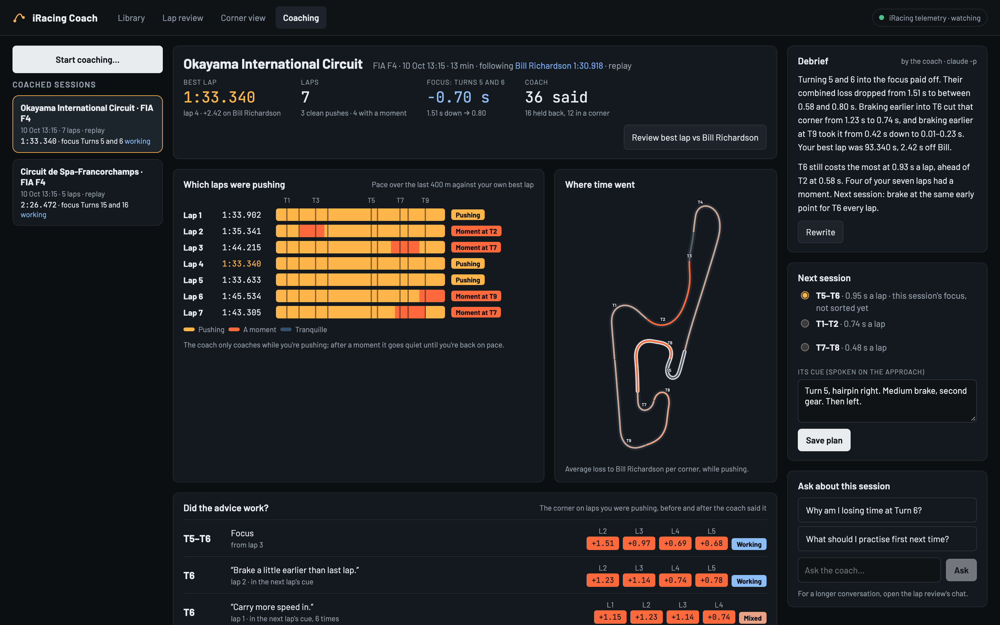

# The browser UI

`iagent ui` opens the coach in your browser: a library of your laps, lap review against a ghost,
a corner view, coach chat, and the Coaching tab for live sessions.

| Library | Lap review |
| --- | --- |
|  |  |
| **Corner view** | **Coaching** |
|  |  |

## Building and running it

The UI is a React app in [web/](../web/). Build it once (needs [Node.js](https://nodejs.org) 20+),
then run:

```bash
npm --prefix web install && npm --prefix web run build   # writes iagent/ui/static/
iagent ui                                                 # http://127.0.0.1:8765, Ctrl+C to stop
```

While working on the UI, run `iagent ui --no-browser` and `npm --prefix web run dev` (hot
reload on http://localhost:5173, API calls forwarded to the server).

The server only answers on localhost (pass `--host 0.0.0.0` to open it from another machine) and
refuses POSTs without the web app's `X-Iagent` header, so other sites open in your browser can't
start the coach or write to the workspace.

## Library

Where laps come from, every track you've driven, and each session's laps with a Review and a
Ghost choice (your laps or Garage61 teammates'). It also shows whether Garage61 is connected (a
token can be added there) and whether `claude` was found.

- **On the sim PC** `iagent ui` watches Documents/iRacing/telemetry and ingests each recording
  when the session ends (header pill).
- **On a Mac**, drop `.ibt` files onto the library, or point it at a folder synced from the sim
  PC (OneDrive, Dropbox, a network share), which is then watched like iRacing's own.

The watched folder is the one last chosen in the library (saved in the workspace's
`settings.json`), else `IAGENT_TELEMETRY_DIR`, else `Documents/iRacing/telemetry`;
`--telemetry-dir` overrides all three, and `--no-watch` turns watching off. `iagent ui` also
starts on an empty workspace, on the library.

## Lap review

- **Track map.** Your line, coloured by the time you gained or lost in each corner.
- **Corner table.** Each corner's comparison against the ghost.
- **Traces.** Gap to ghost, speed, throttle, brake, gear and steering against distance, shaded
  blue where you're ahead of the ghost and orange where you're behind. Hover to follow both cars
  on the map, drag to zoom, double-click to reset. A "time lost per 10 m" bar chart shows where
  the gap grows; chips toggle speed difference, steering and line offset.
- **Corner view.** One corner at a time (open it from the corner card, or the coach opens it):
  both racing lines with the sideways gap exaggerated ×3/×5/×10 (distance along the track stays
  true), a gap ladder, your line coloured by speed against the ghost, brake and full-throttle
  points, the corner's numbers and its traces.
- **Coach chat.** Ask about the lap beside the analysis. The coach is your own Claude Code
  (`claude -p` with the coach plugin: your subscription, no API key) and knows what's on screen.
  When it talks about a corner it points at it, running `iagent ui show --corner 9 --view corner`
  to select, zoom and switch the map. Set `IAGENT_CLAUDE` if `claude` isn't on your PATH, and
  `IAGENT_COACH_MODEL` to pick a model.

The ghost defaults to the fastest Garage61 teammate lap for the track and car (imported on first
open), otherwise your next-best lap. A Garage61 ghost can be installed into iRacing in one click
on the sim PC; elsewhere the button downloads the `.blap` to copy over. The URL (lap, ghost,
corner, view) can be bookmarked.

## Coaching

The **Coaching** tab starts the [live coach](live-coach.md) (iRacing, or a replay of a
recording) and, afterwards, reviews each coached session:

- which laps you were pushing, and where a moment or a tranquille stretch was;
- where the time went (a map of the average loss per corner while pushing);
- **did the advice work?** each piece of advice with that corner before and after, judged on the
  laps you were pushing ("working", "mixed", "not yet"), and how the focus went;
- everything the coach said, lap by lap, including what it held back and why, with links into the
  corner view;
- a debrief written by the coach (`claude -p`), questions about the session, and **the next
  session's plan**: pick its focus and edit that corner's cue. A planned focus starts the next
  two sessions at that track, and is re-checked after two pushing laps, so it can't get stuck on
  something already sorted;
- **Debug: the whole loop**: every event (but frames and ticks), every rule firing with the
  values it saw, and each engineer turn with its exact prompt, reply and timing. It follows a
  running session.
